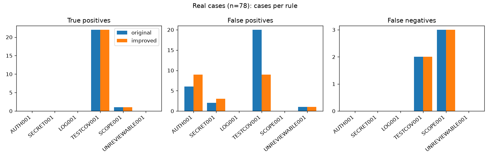
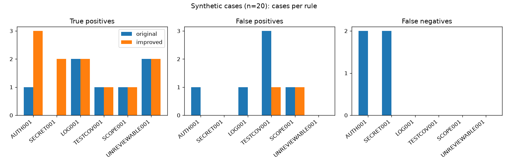

# AgentProof: Evaluation Report

## Summary

AgentProof is a command-line tool that audits a code change (a git branch)
with six deterministic rules, gives it a risk score, and recommends
approve, review or reject. This report evaluates the tool on 78 real pull
requests opened by AI coding agents and 20 hand-written synthetic cases.
Every label was reviewed by a human. Every number below comes from a
committed results file, produced by a command listed in
[Reproducing the results](#10-reproducing-the-results).

Main findings:

- **Detection.** On the 78 real cases, the improved version reports at
  least one finding on 25 of the 27 cases labeled risky. Measured as
  "any finding" against the label, its precision is 0.60, its recall 0.93
  and its F1 0.72; the original version scored 0.51, 0.89 and 0.65.
  On the held-out half, never used for any tuning, the improved version
  scores 0.52, 0.85 and 0.65.
- **Where the rules fail:**
  - The security rules (AUTH001, SECRET001, LOG001) produce false
    positives on real pull requests, and there were no real security
    positives to catch.
  - SCOPE001 finds 1 of 4 real scope problems.
  - The default scoring flags only 2 of 27 risky real cases for review.
- **LLM verifier.** With the only local model that could complete the
  benchmark on the available 8 GB Mac (`qwen2.5-coder:1.5b`), the verifier
  suppressed nothing. Its results equal the rules'. Asked on its own, the
  model called every case risky. No improvement from the LLM was measured.

## 1. Research question

> Can simple rules catch risky AI-generated code changes, where do they
> fail, and does an LLM verifier help?

"Risky" means one of six concrete concerns, defined in
[`eval/LABELING_GUIDE.md`](../eval/LABELING_GUIDE.md).

Three are **security concerns**:

- **AUTH001:** a security check removed;
- **SECRET001:** a hardcoded credential;
- **LOG001:** a secret written to a log.

Three are **review concerns**:

- **TESTCOV001:** behavior changed without tests;
- **SCOPE001:** changes unrelated to the task;
- **UNREVIEWABLE001:** content a reviewer cannot inspect.

None of these risks is specific to AI-written code. A human can make
every one of them. The dataset uses AI-agent pull requests because that is
the tool's intended use.

## 2. Method and architecture

```
git diff base...branch -U0
   -> diff_parser   (added and deleted lines with line numbers)
   -> 6 rules       (each: check(file_diffs, task) -> findings)
   -> ignores, grouping, configuration   (engine.collect_findings)
   -> [optional] local LLM verifier       (--llm-verify)
   -> scoring       (engine.py)
   -> terminal | HTML | JSON | SARIF report
```

**Rules.** Each rule is a module in `agentproof/rules/`. All six work on
the text of the diff; none runs or builds the code.

| Rule | Looks for | Severity |
|---|---|---|
| AUTH001 | Deleted lines containing security words (`authorize`, `login_required`, `verify`, `csrf`, ...) as whole words of identifiers, including decorators | high |
| SECRET001 | Added credential-named fields with a quoted literal, and known token shapes (`sk-`, AWS, GitHub, Slack, PEM private keys) | high, or critical for known token shapes |
| LOG001 | Sensitive values passed to `print`/logging calls (not words in static messages) | high |
| TESTCOV001 | A changed source file when no file *named like a test* changed | medium |
| SCOPE001 | A changed file sharing no word with the task text | medium |
| UNREVIEWABLE001 | Binary files and pure renames | medium or low |

TESTCOV001 detects whether a test file changed. **It does not measure test
coverage:** any changed test file satisfies it.

**Scoring.** Each finding adds points by severity: critical 30, high 20,
medium 10, low 5, capped at 100. A score of 30 or more means "review", and
60 or more means "reject". Scoring lives in `engine.py`. Several
safeguards come before it:

- related findings from one deleted block are counted once;
- `agentproof: ignore[RULE]` directives drop findings on their own line;
- an optional `.agentproof.toml`, read from the base branch, can change
  the rules, severities and thresholds;
- every output redacts secrets.

**Optional LLM verifier** (`--llm-verify`;
[`docs/LLM_VERIFIER.md`](LLM_VERIFIER.md)). After the rules run, each
finding goes to a local Ollama model with a bounded excerpt: about 20
changed lines and the task. The model is asked *"Is this change actually
risky? Answer yes/no with a one-sentence reason."*

The finding is suppressed only on an exactly formatted "no". The finding is
kept, and the model is not asked, when:

- the finding is critical;
- the text seems to address an AI model (a prompt-injection heuristic).

The finding is also kept when the model's reply is malformed or the
request times out. If Ollama cannot be reached, the report says it is
rules-only.

The verifier can remove findings but cannot add any, so it cannot catch a
risk the rules missed. Only a local server is used; nothing is sent to a
cloud service.

## 3. Dataset

**Real pull requests** ([`eval/README.md`](../eval/README.md)):

- **Source.** Merged public pull requests from 2026-07-01 to 2026-09-30,
  each opened by the verified bot account of one of seven AI coding-agent
  GitHub Apps.
- **Filters:**
  - the repository has at least 10 stars and is not a fork or archived;
  - the PR has at most 50 changed files and 1,500 changed lines;
  - at most 2 PRs come from any one repository.
- **Collection.** 1,846 candidate PRs were examined, and **78 were
  collected, from 66 repositories**. By agent: Claude Code 18, Copilot
  18, Cursor 18, Devin 18, Jules 6. Amazon Q and Codegen yielded none.
- **Exclusions** (most common first):

  | Reason | Count |
  |---|---|
  | Repository below 10 stars | 1,630 |
  | Fork | 59 |
  | Per-repository cap | 56 |
  | Archived | 18 |
  | Too many changed lines | 3 |
  | Too many files | 2 |

- **Storage.** Each diff is pinned to exact commits and a checksum in
  `eval/manifest.csv`. The diffs themselves are not committed, because they
  are third-party code under many licenses.

**Synthetic cases.** 20 cases were written by hand to give each rule
positive and negative examples. They were written knowing how the rules
work, so they show whether the rules behave as designed, not how well they
work on real code. Where a case adds a test, the test contains real
assertions about the changed code, but these embedded tests were never
executed.

**Labels.** The labels were made in two steps:

1. Tentative labels were drafted from each PR's title, description and
   diff, without running AgentProof first.
2. A human reviewer checked every row and set it to `confirmed` (97 rows)
   or `corrected` (1 row).

The review also settled the rules for judgment calls, now written in the
guide. For example:

- only tests in the PR itself count for TESTCOV001;
- presentation-only changes need no tests;
- a stale PR description is not by itself a scope problem.

| Label counts | Real (78) | Synthetic (20) |
|---|---|---|
| Labeled risky | 27 | 11 |
| TESTCOV001 | 24 | 1 |
| SCOPE001 | 4 | 1 |
| AUTH001 / SECRET001 / LOG001 | 0 / 0 / 0 | 3 / 2 / 2 |
| UNREVIEWABLE001 | 0 | 2 |

**No real PR has a security positive.** Recall for the security rules can
only be measured on the synthetic cases.

## 4. Evaluation definitions

- **Per case.** A rule *predicts* a case when it reports at least one
  finding in it. The case is *positive* for that rule when the rule is in
  the case's label. Each rule gets true and false positives and negatives,
  precision, recall, F1 and the false-positive rate (FP / (FP + TN)).
- **Undefined scores.** A score with a zero denominator is reported as N/A,
  never as 0 or 1. Examples: recall with no positives, or precision for a
  rule that never fired.
- **Detection vs scoring.** These are measured separately:
  - *detection* asks whether AgentProof reported any finding on a case
    labeled risky;
  - *scoring* asks whether its score reached "review" or "reject".
- **Fixed split.** Before any result was computed, the real cases were
  split into development (38) and held-out (40) sets:
  - the split is grouped by repository and balanced by risk, with no
    randomness;
  - it is committed as `eval/split.csv`;
  - all synthetic cases are development cases;
  - no rule was tuned on the evaluation data.
- **Real and synthetic cases are never combined.**
- **Before/after comparison.** The original commit `819cbb2` and the
  improved commit `ef68833` run from separate git worktrees on identical
  input. The rule code has not changed since `ef68833`.
- **Input format.** The dataset diffs contain context lines, but
  AgentProof reads git's `-U0` format. A converter (`eval/u0.py`) was
  checked against git itself on 200 random edits and all 20 synthetic
  cases, and end to end against AgentProof's normal path.

## 5. Results: rules, before and after

Source: [`eval/results/comparison.md`](../eval/results/comparison.md),
produced by `python -m eval.run_eval`. Cells show
*before → after*.

**Real cases, all 78:**

| Scope | Positives | Precision | Recall | F1 | FP rate |
|---|---|---|---|---|---|
| Any finding vs labeled risky | 27 | 0.51 → 0.60 | 0.89 → 0.93 | 0.65 → 0.72 | 0.45 → 0.33 |
| Review or reject vs labeled risky | 27 | 0.40 → 0.25 | 0.07 → 0.07 | 0.12 → 0.11 | 0.06 → 0.12 |
| TESTCOV001 | 24 | 0.52 → 0.71 | 0.92 → 0.92 | 0.67 → 0.80 | 0.37 → 0.17 |
| SCOPE001 | 4 | 1.00 → 1.00 | 0.25 → 0.25 | 0.40 → 0.40 | 0.00 → 0.00 |
| AUTH001 | 0 | 0.00 → 0.00 | N/A | N/A | 0.08 → 0.12 |
| SECRET001 | 0 | 0.00 → 0.00 | N/A | N/A | 0.03 → 0.04 |
| LOG001 | 0 | N/A | N/A | N/A | 0.00 → 0.00 |
| UNREVIEWABLE001 | 0 | 0.00 → 0.00 | N/A | N/A | 0.01 → 0.01 |

**Real held-out cases (40; never used for tuning), any finding:**

| | Before | After |
|---|---|---|
| Precision | 0.44 | 0.52 |
| Recall | 0.85 | 0.85 |
| F1 | 0.58 | 0.65 |

On the development cases (38) the scores are 0.59 → 0.67, 0.93 → 1.00 and
0.72 → 0.80.

**Synthetic cases (20).** Any finding: precision 0.75 → 1.00, recall
0.82 → 1.00, F1 0.78 → 1.00. On the security rules (7 positives), recall
went from 0.43 to 1.00.





**How the changes break down:**

- **TESTCOV001:** false positives fell from 20 to 9, because the improved
  version recognizes more test-file conventions.
- **AUTH001 and SECRET001:** false positives rose from 6 to 9 and from 2 to
  3, because these rules now detect more names and secret shapes.
- **Parser fix:** the Phase 5 fix changed no result on this dataset.
- **Scoring:** recall stayed at 0.07, because the default scoring lets
  every real risky case through on its own:
  - all 27 are TESTCOV001 or SCOPE001 cases, worth 10 points, while
    "review" starts at 30;
  - a single AUTH001 finding is worth 20 points;
  - grouping a removed two-line block into one finding moved synthetic
    case `syn-01` from 40 points (review) to 20 (approve).

## 6. Results: rules vs LLM only vs hybrid

Source: [`eval/results/llm/`](../eval/results/llm/), produced by
`python -m eval.run_llm_eval --model qwen2.5-coder:1.5b`. The run used
Ollama 0.20.6, temperature 0 and a 4,096-token context, on a MacBook Air
M3 with 8 GB.

**Why 1.5B.** The preferred model, `qwen2.5-coder:7b`, finished only a
5-case check. During its full run the Mac froze at case 13 of 98 and had to
be force-restarted with the power button. The 1.5B model is a much weaker
fallback.

**Coverage:**

- all 98 cases were processed and 96 were scored;
- 2 held-out cases were excluded from every mode because the model's
  LLM-only reply was malformed;
- there were no timeouts.

The hybrid verifier asked the model about 90 findings and got 90 "risky"
decisions, with no "not risky". In addition:

- 2 critical findings were kept by policy;
- 1 was kept by the injection check, on a PR whose description mentions a
  "system prompt";
- 4 replies were malformed, and those findings were kept.

Precision / recall / F1 on the scored cases, any finding vs labeled risky:

| Cases | Rules only | LLM only | Hybrid |
|---|---|---|---|
| Real, all (76) | 0.61 / 0.93 / 0.74 | 0.36 / 1.00 / 0.52 | 0.61 / 0.93 / 0.74 |
| Real, held-out (38) | 0.55 / 0.85 / 0.67 | 0.34 / 1.00 / 0.51 | 0.55 / 0.85 / 0.67 |
| Synthetic (20) | 1.00 / 1.00 / 1.00 | 0.55 / 1.00 / 0.71 | 1.00 / 1.00 / 1.00 |

Average time per case on real cases:

| Mode | Time per case |
|---|---|
| Rules only | 0.00 s |
| Hybrid | 2.28 s |
| LLM only | 4.82 s |

Cost: local, with no paid API. Hardware, electricity and time are still
real costs.

What this shows:

- **Hybrid changed nothing.** Because the model never answered "not
  risky", it suppressed nothing, and its scores equal the rules'.
- **LLM only reported a risk on every scored case.** Its recall of 1.00
  reflects that, not good detection.
- **LLM only also did badly on specific rules:**
  - it found none of the 24 real TESTCOV001 cases;
  - it reported AUTH001, SECRET001 and LOG001 on real cases that have no
    such label, so its precision for each is 0.00.
- **No improvement from the LLM was measured.** This holds only for this
  model and this setup. Whether a larger model would help was not
  measured.

The benchmark saved each model call's parsed status and one-sentence
reason, not the model's raw reply. The parsed decisions can be recomputed
and checked from `eval/results/llm/`; the exact original replies cannot. For example, 4 saved hybrid decisions (all AUTH001 in `novu-11754`)
give a reason starting "The flagged change is not actually risky" while
the parsed answer was "risky".

## 7. Failure analysis

These are the improved version's errors on real cases. The full list is in
[`eval/results/README.md`](../eval/results/README.md).

**False positives** (22 case/rule pairs: AUTH001 9, SECRET001 3,
TESTCOV001 9, UNREVIEWABLE001 1). They fall into a few patterns:

- **Deleted text that is not code.** AUTH001 fires on lockfile package
  names (`better-auth`, `google-auth-library` in `novu-11754`, which scores
  100 and is rejected), on Markdown documentation and on a Windows batch
  `@rem` comment.
- **Identifier splitting on data.** Splitting `AIVerifyNGStepNode` yields
  "verify" (`mcp-server-509`/`-510`). These are new false positives in the
  improved version.
- **Rewritten checks.** In `dotnet runtime-130061`, permission checks were
  rewritten with the final checks kept. AUTH001 sees only the deleted
  lines.
- **Fake values in tests.** SECRET001 fires on fake keys such as
  `STRIPE_SECRET_KEY = 'sk_t****'` in test files.
- **Tests that file names don't reveal.** TESTCOV001 cannot see Rust
  inline `#[cfg(test)]` tests or helpers under `e2e/`, and it fires on
  presentation-only changes.

**False negatives** (5):

- **TESTCOV001, 2 cases:**
  - `windows-msix-38`: a test-file edit that does not exercise the change
    satisfies the rule;
  - `InterKnot-Web-64`: `.vue` is not in the list of source-file
    extensions.
- **SCOPE001, 3 cases** (`pcgen-7653`, `gh-aw-42590`,
  `mcp-server-510`): one shared word is enough to count a file as related,
  and a long PR description supplies many words.

**LLM failure modes:**

- the 1.5B model answered "risky" to every question;
- 6 replies were malformed;
- the injection heuristic fires on legitimate AI-application text;
- the 7B model was too large for the 8 GB machine.

## 8. Limitations

- **A clean audit does not prove a change is safe.** The rules only look
  for six patterns, by text.
- **Few positives.** There are no real security positives, and SCOPE001
  has 4 real positives, so a single case moves a score a lot.
- **One reviewer.** The labels come from one human reviewer, with no
  second independent review.
- **Selection bias.** Only merged PRs from public repositories with 10 or
  more stars, from three months of 2026, are included, and there is
  clustering by organization.
- **Synthetic cases are not independent.** They were written knowing how
  the rules work, and their embedded tests were never run.
- **Default configuration only.** Only the default severities and
  thresholds were evaluated.
- **The LLM results cover one small model,** in one run on one machine.
- **The GitHub Action has not been run** on GitHub-hosted runners. Its
  shell steps are tested locally (`tests/test_action.py`).
- **Not a tamper-resistant security gate.** An `agentproof: ignore[...]`
  directive on an added line comes from the change being audited. A change
  can use one to silence its own finding, for example a hardcoded secret,
  and still be approved; this was confirmed in testing. The README
  documents it, but documenting it does not prevent it.
- **Detection gaps found in the final review** (listed in the README's
  Known Limitations):
  - SECRET001 misses names such as `aws_secret_access_key`, type-annotated
    assignments, Go's `:=` and `sk_live_` keys;
  - AUTH001 counts SQL and HTML comments and words in strings;
  - quoted non-ASCII file names are shown wrongly;
  - mode-only changes are invisible.
- **Python versions.** The test suite passed on Python 3.10, 3.11 and
  3.12 in the GitHub Tests workflow at commit `36eb6b2`
  ([run 38996141338](https://github.com/Dhruvshetty225/agentproof/actions/runs/38996141338)), and on 3.12 locally. The project
  declares 3.9 or later; 3.9 was not tested.
- **Raw model replies were not saved,** so the exact LLM replies cannot be
  checked; the parsed decisions can.

## 9. Next steps

These are possible next steps, not done and not measured:

- **Fix the false-positive patterns,** tuned on development cases only:
  - skip lockfiles and documentation in AUTH001;
  - treat fake values in test files differently in SECRET001;
  - require more than one shared word in SCOPE001, or weight rare words;
  - add `.vue` and similar extensions to TESTCOV001.
- **Revisit scoring,** so that a removed security check or untested
  behavior can reach "review" by default.
- **Collect real security positives,** for example over a wider window,
  to measure security recall on real data.
- **Measure a larger local model** on a machine with more memory.

## 10. Reproducing the results

```bash
pip install -e . pytest jsonschema matplotlib
python -m pytest -q                                   # test suite
python -m eval.summarize_dataset                      # dataset and label counts
GITHUB_TOKEN=... python -m eval.collect --from-manifest eval/manifest.csv   # re-download real diffs
python -m eval.run_eval                               # rules before/after -> eval/results/
python -m eval.run_llm_eval --model qwen2.5-coder:1.5b  # needs local Ollama -> eval/results/llm/
```

The software versions and dataset checksums for each run are recorded in
`eval/results/environment.json` and `eval/results/llm/environment.json`.
